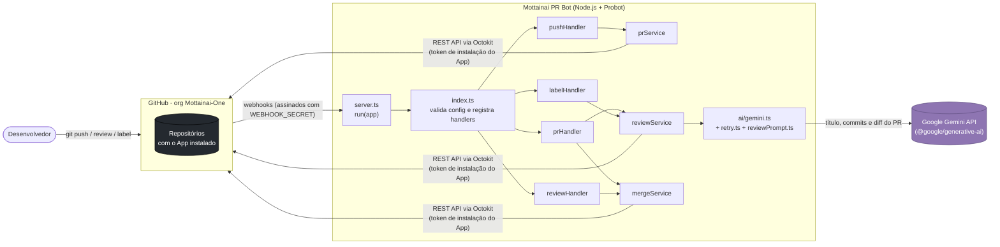
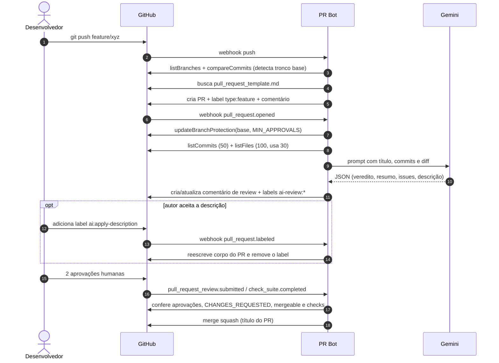
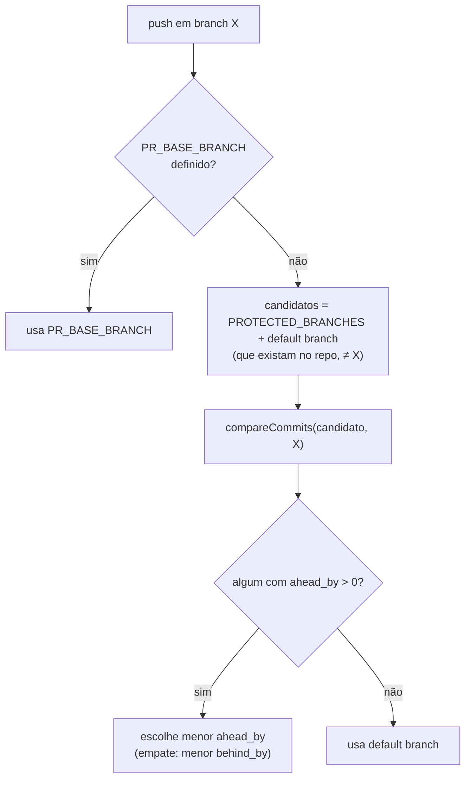
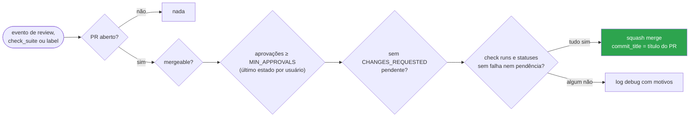

<div align="center">

# Mottainai PR Bot

**GitHub App que automatiza o ciclo de Pull Requests da organização Mottainai-One**

*Push numa branch de trabalho vira PR, o diff é revisado por IA (Google Gemini), o autor decide se aplica a descrição sugerida e o merge (squash) acontece sozinho depois de 2 aprovações humanas e checks verdes.*

<br/>

[](tsconfig.json)
[](package.json)
[](https://probot.github.io/)
[](src/ai/gemini.ts)

[](Dockerfile)
[](render.yaml)
[](scripts/dev.mjs)
[](tests)
[-lightgrey?style=flat-square)](package.json)
[](#11-status-e-roadmap)

<br/>

[Visão geral](#1-visão-geral) •
[Arquitetura](#2-arquitetura) •
[Tecnologias](#3-tecnologias) •
[Fluxos](#5-como-funciona) •
[Configuração](#6-configuração) •
[Execução](#7-instalação-e-execução) •
[Segurança](#9-segurança) •
[Limitações](#10-limitações-riscos-e-divergências)

</div>

---

## 1. Visão geral

O **Mottainai** (もったいない, *"que desperdício"*) é um sistema de gestão preditiva de estoque para pequenos e médios varejos, organizado em vários repositórios na org [Mottainai-One](https://github.com/Mottainai-One). O **PR Bot** não faz parte do produto: é uma **ferramenta de engenharia** que padroniza como o time abre, revisa e mergeia Pull Requests em todos esses repositórios.

É um **GitHub App** escrito em TypeScript sobre o framework **Probot**. Ele roda como um servidor HTTP que recebe webhooks do GitHub. Não é uma GitHub Action: não existe `action.yml` nem workflow em `.github/`.

| | Capacidade | Onde está no código |
|---|---|---|
| **1** | **Auto-PR**: push numa branch que não é tronco abre um PR com título Conventional Commits, template e label de tipo | `src/handlers/pushHandler.ts`, `src/services/prService.ts`, `src/github/prTemplate.ts` |
| **2** | **Revisão por IA**: o diff e os commits vão para o Gemini, que devolve um JSON com veredito, resumo, tipo, problemas e descrição sugerida | `src/handlers/prHandler.ts`, `src/services/reviewService.ts`, `src/ai/*` |
| **3** | **Descrição sob aceite do autor**: o label `ai:apply-description`, aplicado **pelo autor do PR**, reescreve o corpo do PR com a sugestão da IA | `src/handlers/labelHandler.ts` |
| **4** | **Branch protection automática**: a branch base do PR passa a exigir `MIN_APPROVALS` aprovações | `src/services/mergeService.ts` (`ensureBranchProtection`) |
| **5** | **Auto-merge (squash)**: com aprovações suficientes, sem pedido de mudança pendente, PR mergeável e checks OK | `src/handlers/reviewHandler.ts`, `src/services/mergeService.ts` |

> [!NOTE]
> O veredito da IA (`APPROVE` / `REQUEST_CHANGES` / `COMMENT`) é **apenas consultivo**: ele vira comentário e labels `ai-review:*`, mas **não entra** nas condições de auto-merge. Quem decide são as aprovações humanas e os checks.

---

## 2. Arquitetura

### Visão de componentes



### Camadas do código

| Camada | Pasta | Responsabilidade |
|---|---|---|
| Bootstrap | `src/server.ts`, `src/index.ts`, `src/config.ts` | Sobe o Probot, carrega `.env` e aborta o registro dos handlers se faltar `APP_ID`, `PRIVATE_KEY`, `WEBHOOK_SECRET` ou `GEMINI_API_KEY` |
| Handlers | `src/handlers/` | Um arquivo por grupo de eventos do GitHub; filtram repositórios ignorados, bots e drafts |
| Serviços | `src/services/` | Regras de negócio: base do PR, template, labels, review, proteção de branch, condições de merge |
| IA | `src/ai/` | Prompt, cliente Gemini em modo JSON, retry com backoff e tipos do resultado |
| GitHub utils | `src/github/` | Template padrão de PR e geração de título a partir da branch/commit |

---

## 3. Tecnologias

<table>
<tr>
<td align="center" width="140"><br/><b>TypeScript 5.9.3</b><br/><sub>ES2022, NodeNext,<br/><code>strict</code></sub></td>
<td align="center" width="140"><br/><b>Node.js</b><br/><sub><code>engines: &gt;=18</code><br/>Docker: 20-alpine</sub></td>
<td align="center" width="140"><br/><b>Probot 13.4.7</b><br/><sub>Servidor de webhooks<br/>+ Octokit autenticado</sub></td>
<td align="center" width="140"><br/><b>Gemini</b><br/><sub><code>@google/generative-ai</code><br/>0.21.0</sub></td>
</tr>
<tr>
<td align="center" width="140"><br/><b>GitHub App</b><br/><sub>Webhooks + REST API</sub></td>
<td align="center" width="140"><br/><b>Docker</b><br/><sub>Build multi-stage<br/>+ Compose</sub></td>
<td align="center" width="140"><br/><b>Render</b><br/><sub>Blueprint<br/>(<code>render.yaml</code>, plano free)</sub></td>
<td align="center" width="140"><br/><b>dotenv 16.6.1</b><br/><sub>Config local<br/>via <code>.env</code></sub></td>
</tr>
</table>

### Dependências (versões resolvidas no `package-lock.json`, lockfile v3)

| Pacote | Tipo | Faixa no `package.json` | Versão travada |
|---|---|---|---|
| `probot` | runtime | `^13.3.0` | 13.4.7 |
| `@google/generative-ai` | runtime | `^0.21.0` | 0.21.0 |
| `dotenv` | runtime | `^16.4.5` | 16.6.1 |
| `typescript` | dev | `^5.5.0` | 5.9.3 |
| `tsx` | dev | `^4.19.0` | 4.23.1 |
| `smee-client` | dev | `^1.2.3` | 1.2.3 |
| `@types/node` | dev | `^20.14.0` | 20.19.43 |

> [!NOTE]
> O `package.json` usa faixas com `^`. A reprodutibilidade depende do `package-lock.json` e de `npm ci` (que é o que o `Dockerfile` e o `render.yaml` usam).

---

## 4. Estrutura do repositório

```text
Mottainai-PR-Bot/
├── src/
│   ├── server.ts                 # run(app) do Probot
│   ├── index.ts                  # Valida config obrigatória e registra os 4 handlers
│   ├── config.ts                 # Leitura do ambiente (dotenv com override) e defaults
│   ├── ai/
│   │   ├── gemini.ts             # Cliente Gemini: temperature 0.2, responseMimeType JSON
│   │   ├── retry.ts              # Backoff exponencial com jitter para 408/429/5xx e erros de rede
│   │   ├── reviewPrompt.ts       # Prompt do revisor + truncamento de patches (6000 chars/arquivo)
│   │   └── types.ts              # PrReviewResult e marcadores HTML dos comentários
│   ├── github/
│   │   └── prTemplate.ts         # Template padrão, título Conventional Commits, tipo pela branch
│   ├── handlers/
│   │   ├── pushHandler.ts        # push → cria PR, label de tipo e comentário
│   │   ├── prHandler.ts          # pull_request.opened/reopened/synchronize → review IA
│   │   ├── labelHandler.ts       # pull_request.labeled (ai:apply-description) → aplica descrição
│   │   └── reviewHandler.ts      # reviews, check_suite e labels → tenta auto-merge
│   └── services/
│       ├── prService.ts          # Base do PR, PR existente, template do repo, criação, labels
│       ├── reviewService.ts      # Coleta diff, chama IA, formata/atualiza comentário, labels ai-review:*
│       └── mergeService.ts       # Branch protection, contagem de reviews, checks e squash merge
├── tests/
│   ├── mergeService.test.ts      # 2 testes
│   ├── retry.test.ts             # 4 testes
│   └── reviewPrompt.test.ts      # 4 testes
├── scripts/
│   ├── dev.mjs                   # Sobe Smee + bot (tsx watch) juntos
│   └── post-push                 # Hook shell que procura o PR criado (usa gh CLI)
├── .env.example
├── Dockerfile                    # Multi-stage node:20-alpine, roda como usuário node
├── docker-compose.yml            # Serviço pr-bot, env_file .env, porta 3000
├── render.yaml                   # Blueprint Render (web service, plano free)
├── package.json / package-lock.json
├── tsconfig.json
└── README.md
```

Não existem `.github/workflows`, `action.yml`, `app.yml` (manifesto do App), `LICENSE` nem `.dockerignore` na `main`.

---

## 5. Como funciona

### Eventos escutados

| Evento GitHub | Handler | O que acontece |
|---|---|---|
| `push` | `pushHandler` | Se a branch não é tronco nem protegida e não há PR aberto, cria PR, aplica `type:<tipo>` e comenta |
| `pull_request.opened` | `prHandler` | Ignora drafts. Aplica branch protection na base, gera review IA e posta comentário; se a IA falhar, comenta o erro no PR |
| `pull_request.reopened` | `prHandler` | Gera o review novamente (inclusive em drafts) |
| `pull_request.synchronize` | `prHandler` | Ignora drafts. Atualiza o mesmo comentário de review após novo push |
| `pull_request.labeled` | `labelHandler` e `reviewHandler` | `ai:apply-description` aplica a descrição; qualquer label também dispara uma tentativa de auto-merge |
| `pull_request_review.submitted` | `reviewHandler` | Ignora reviews de bots. Reaplica branch protection e tenta auto-merge |
| `pull_request_review.edited` | `reviewHandler` | Tenta auto-merge |
| `check_suite.completed` | `reviewHandler` | Tenta auto-merge para cada PR associado à suíte |

### Ciclo de vida de um PR



### Escolha da branch base



O título do PR segue Conventional Commits: se a primeira mensagem de commit do push já tem prefixo válido (até 72 caracteres), ela é usada; senão o prefixo vem da branch (`feature/` e `feat/` → `feat`, `fix/`, `bugfix/` e `hotfix/` → `fix`, `docs/`, `refactor/`, `test/`, `chore/`, `ci/`, `infra/` → `ci`, `release/` → `chore`; padrão `feat`).

O corpo usa o primeiro template encontrado em `pull_request_template.md`, `.github/pull_request_template.md` ou `docs/pull_request_template.md`, procurando na base, nas branches protegidas e na default. Se nenhum existir, usa o template embutido em `src/github/prTemplate.ts`.

### Revisão por IA

<details>
<summary><b>Prompt, limites e formato da resposta</b></summary>

<br/>

- **Entrada:** `owner/repo`, número e título do PR, branch → base, primeira linha de até 50 commits e até **30 arquivos** (dos 100 primeiros listados) com `additions > 0` ou `deletions > 0`.
- **Truncamento:** cada patch é limitado a **6000 caracteres**, preservando início e fim com um marcador explícito. O prompt instrui o modelo a não acusar arquivo incompleto só por causa do corte (correção do commit `f82d2ae`).
- **Modelo:** `GEMINI_MODEL`, com `temperature: 0.2` e `responseMimeType: "application/json"`.
- **Saída esperada:** `summary`, `typeOfChange`, `changesMade[]`, `issuesFound[]` (`HIGH`/`MEDIUM`/`LOW`), `recommendation` e `suggestedDescription`. Campos ausentes recebem defaults (`Feature`, `COMMENT`, listas vazias).
- **Retry:** até `GEMINI_MAX_ATTEMPTS` tentativas para HTTP 408, 429, 500, 502, 503, 504 e erros de rede (`ECONNRESET`, `ETIMEDOUT` etc.), com backoff exponencial a partir de `GEMINI_RETRY_BASE_DELAY_MS`, jitter de ±25% e teto de 30 s.
- **Persistência:** o comentário carrega o marcador `<!-- MOTTAINAI-BOT-REVIEW -->` e o JSON do review em **base64** entre marcadores HTML. O `labelHandler` lê esse JSON para aplicar a descrição sem chamar a IA de novo.

</details>

<details>
<summary><b>O que o label <code>ai:apply-description</code> faz no corpo do PR</b></summary>

<br/>

1. Só funciona se quem aplicou o label é o **autor do PR** e o PR está aberto; senão o label é removido com um aviso.
2. Procura o primeiro comentário de bot com o marcador de review; se não houver ou o JSON não decodificar, remove o label e avisa.
3. Substitui a seção `## Description` pelo `summary` e os itens de `## Changes Made` por `changesMade`.
4. Remove as linhas automáticas (`Automated PR for branch`, `**Latest commit:`), marca o checkbox do tipo de mudança e marca `Code reviewed`.
5. Atualiza o PR, remove o label e comenta a confirmação.

O resultado depende de o corpo seguir os cabeçalhos do template (`## Description`, `## Changes Made`). Templates de repositório com outros títulos não são reescritos nessas seções.

</details>

### Condições de auto-merge



A contagem considera o **estado mais recente** de cada revisor entre `APPROVED`, `CHANGES_REQUESTED` e `DISMISSED` (`COMMENTED` não sobrescreve). A proteção é configurada com `dismiss_stale_reviews: false`, então aprovações **sobrevivem a novos commits** (decisão coberta por teste em `tests/mergeService.test.ts`).

---

## 6. Configuração

### Permissões do GitHub App

Não há manifesto (`app.yml`) no repositório. A tabela abaixo vem do `README.md` original e bate com as chamadas de API feitas pelo código.

| Permissão | Acesso | Usada para |
|---|---|---|
| Contents | Read and write | Listar branches, comparar commits, ler template, merge |
| Pull requests | Read and write | Criar, ler, atualizar e mergear PRs; listar reviews, commits e arquivos |
| Issues | Read and write | Comentários e labels |
| Checks | Read | `checks.listForRef` |
| Administration | Read and write | `repos.updateBranchProtection` |
| Metadata | Read | Obrigatória |

Eventos a assinar: `push`, `pull_request`, `pull_request_review`, `check_suite`.

> [!NOTE]
> O código também chama `repos.getCombinedStatusForRef` (commit statuses). A permissão **Commit statuses: Read** não está listada no README original. Como falhas nessa chamada caem num `catch` que considera os checks aprovados (ver [seção 10](#10-limitações-riscos-e-divergências)), a ausência dela não bloqueia o merge.

### Variáveis de ambiente

| Variável | Obrigatória | Padrão | Lida por | Descrição |
|---|:---:|---|---|---|
| `APP_ID` | sim | — | Probot / `config.ts` | ID do GitHub App |
| `PRIVATE_KEY` | sim* | — | Probot / `config.ts` | Chave privada PEM (uma linha com `\n` literais) |
| `PRIVATE_KEY_PATH` | sim* | — | `config.ts` | Alternativa a `PRIVATE_KEY`: caminho do `.pem` |
| `WEBHOOK_SECRET` | sim | — | Probot / `config.ts` | Secret de assinatura dos webhooks |
| `GEMINI_API_KEY` | sim | — | `config.ts` | Chave do Google AI Studio |
| `GITHUB_ORG` | não | `Mottainai-One` | `config.ts` | Lido, mas **não usado** pela lógica atual |
| `GEMINI_MODEL` | não | `gemini-1.5-flash` | `config.ts` | Modelo Gemini (o `render.yaml` define outro, ver abaixo) |
| `GEMINI_MAX_ATTEMPTS` | não | `4` | `config.ts` | Total de tentativas na API Gemini |
| `GEMINI_RETRY_BASE_DELAY_MS` | não | `2000` | `config.ts` | Atraso inicial do backoff |
| `MIN_APPROVALS` | não | `2` | `config.ts` | Aprovações exigidas (proteção e auto-merge) |
| `IGNORED_REPOS` | não | vazio | `config.ts` | Repositórios ignorados, separados por vírgula |
| `PROTECTED_BRANCHES` | não | `main,develop` | `config.ts` | Troncos: não geram PR e são candidatos a base |
| `PR_BASE_BRANCH` | não | vazio | `config.ts` | Força a base de todos os PRs automáticos |
| `PORT` | não | `3000` | Probot / `dev.mjs` | Porta HTTP |
| `WEBHOOK_PATH` | não | `/api/github/webhooks` (em `dev.mjs`) | `dev.mjs` (e possivelmente Probot) | Caminho do webhook |
| `WEBHOOK_PROXY_URL` | não | vazio | Probot (inferido) | URL de proxy Smee usada pelo Probot |
| `SMEE_URL` | só no `dev:smee` | — | `dev.mjs` | Canal Smee para o túnel local |
| `BASE_URL` | não | `http://localhost:3000` | `config.ts` | Lido, mas **não usado** pela lógica atual |

\* Um dos dois. `PRIVATE_KEY` tem precedência.

> [!WARNING]
> `config.ts` carrega o `.env` com `dotenv.config({ override: true })`: valores do `.env` **sobrescrevem** variáveis já exportadas no shell. Isso surpreende quem tenta sobrepor config pela linha de comando.

> [!CAUTION]
> Nunca versione `.env`, o `.pem`, o `WEBHOOK_SECRET` ou a `GEMINI_API_KEY`. O `.gitignore` já ignora `.env`. Não foi encontrada nenhuma credencial hardcoded nos arquivos versionados da `main`; o `.env.example` traz os campos sensíveis vazios.

---

## 7. Instalação e execução

### Pré-requisitos

- [ ] GitHub App criado na org com as permissões e eventos da [seção 6](#permissões-do-github-app)
- [ ] App ID, private key (`.pem`) e webhook secret em mãos
- [ ] Chave da API Gemini (Google AI Studio)
- [ ] Node.js 18+ (o `Dockerfile` usa 20) e npm
- [ ] Para dev local: um canal em [smee.io](https://smee.io/new)

### Scripts disponíveis (`package.json`)

| Script | Comando executado | Uso |
|---|---|---|
| `npm run build` | `tsc -p tsconfig.json` | Compila `src/` para `dist/` |
| `npm run dev` | `tsx watch src/server.ts` | Bot com hot-reload (sem túnel) |
| `npm run dev:smee` | `node scripts/dev.mjs` | Túnel Smee + bot com hot-reload |
| `npm start` | `node dist/server.js` | Produção (após build) |
| `npm test` | `tsx --test tests/*.test.ts` (3 arquivos listados) | Testes com `node:test` |
| `npm run typecheck` | `tsc --noEmit` | Checagem de tipos |

### Desenvolvimento local

```bash
cp .env.example .env
# preencha APP_ID, PRIVATE_KEY (ou PRIVATE_KEY_PATH), WEBHOOK_SECRET, GEMINI_API_KEY e SMEE_URL
npm ci
npm run dev:smee
```

`scripts/dev.mjs` encaminha `SMEE_URL` para `http://localhost:${PORT}${WEBHOOK_PATH}` (padrão `/api/github/webhooks`) e encerra os dois processos se um deles cair. No GitHub App, a Webhook URL deve ser a própria URL do Smee.

### Docker

```bash
docker compose up -d --build
```

Build multi-stage em `node:20-alpine`: o estágio de build roda `npm ci` + `npm run build`; o de runtime instala só dependências de produção, copia `dist/` e roda como usuário `node` na porta 3000. O Compose lê o `.env` via `env_file` (o `.env` **não** entra na imagem).

### Render

O `render.yaml` define um web service Node no plano **free**, com `npm ci --include=dev && npm run build`, `npm start`, `healthCheckPath: /ping` e `autoDeploy: true`. `APP_ID`, `PRIVATE_KEY`, `WEBHOOK_SECRET` e `GEMINI_API_KEY` são `sync: false` (preenchidas no painel). Depois do deploy, aponte a Webhook URL do App para a URL do serviço.

---

## 8. Testes e qualidade

| Arquivo | Testes | O que cobre |
|---|:---:|---|
| `tests/mergeService.test.ts` | 2 | Proteção com `dismiss_stale_reviews: false`; contagem pelo último estado por revisor |
| `tests/retry.test.ts` | 4 | Detecção de 503 do SDK, retry até recuperar, não repetir erro permanente, limite de tentativas |
| `tests/reviewPrompt.test.ts` | 4 | Patch completo intacto, truncamento com início e fim, patch parcial da API, instrução anti-falso-positivo |

Executar com `npm test`. Os testes **não** foram executados nesta análise.

Lacunas observadas: não há testes para os handlers, `prService` (base, template, título), `applySuggestedDescriptionToBody`, `checksPassed` nem para o parse da resposta do Gemini. Não há lint, formatter nem pipeline de CI no repositório.

---

## 9. Segurança

| Tema | Situação na `main` | Avaliação |
|---|---|---|
| Autenticidade dos webhooks | Probot valida a assinatura com `WEBHOOK_SECRET` | Adequado |
| Contexto de execução | GitHub App, não Action: **não usa** `pull_request_target` nem roda código do PR | Sem risco de execução de código de fork |
| Escopo do token | Token de instalação com Contents, PRs, Issues e **Administration** de escrita | Alto privilégio: pode reescrever proteção de branch e mergear em todos os repos instalados |
| Dados enviados a terceiros | Título, mensagens de commit, nomes de arquivos e até 30 patches (6000 chars cada) vão para a API do Google Gemini | Qualquer segredo commitado por engano no diff sai da org. Termos de uso de dados do plano Gemini usado: **não confirmado no repositório** |
| Prompt injection | Conteúdo do PR entra no prompt sem delimitação/escape | Um PR pode manipular veredito, labels `ai-review:*` e o texto sugerido. **Não** controla o merge |
| Saída do LLM no GitHub | Texto da IA vai cru para comentário Markdown e, sob aceite, para o corpo do PR | Pode conter menções, links ou imagens externas. Mitigado pelo aceite explícito do autor |
| Mensagens de erro | Falha do Gemini no `opened` é comentada no PR com `err.message` | Pode expor detalhes internos da integração em repositório público |
| Aplicação da descrição | Restrita ao autor do PR; ignora eventos de bots | Adequado |
| Container | Runtime sem dev deps, usuário não-root `node` | Adequado |

---

## 10. Limitações, riscos e divergências

### Riscos no comportamento

> [!WARNING]
> **A branch protection é sobrescrita, não mesclada.** `ensureBranchProtection` chama `updateBranchProtection` com `required_status_checks: null`, `restrictions: null` e `enforce_admins: true` toda vez que um PR é aberto ou recebe review. Isso **remove** checks obrigatórios e restrições configurados manualmente na branch, e é aplicado à **branch base de qualquer PR**, inclusive bases que não são troncos.

> [!WARNING]
> **Checks em modo fail-open.** Em `checksPassed`, qualquer erro ao consultar check runs ou statuses retorna `true`. Combinado com `required_status_checks: null`, um problema de permissão ou de API pode liberar o auto-merge com CI vermelho ou pendente.

<details>
<summary><b>Outras limitações observadas no código</b></summary>

<br/>

- **Contagem de aprovações:** `summarizeReviews` conta aprovações de qualquer usuário, sem verificar permissão de escrita. A barreira real é a branch protection do GitHub; se `ensureBranchProtection` falhar (por exemplo, sem permissão de Administration), o bot mergeia com a própria contagem.
- **Push de deleção de branch:** o `pushHandler` não verifica `payload.deleted`; o push que apaga uma branch deve fazer `pulls.create` falhar (erro só logado). Inferido pela leitura, não testado.
- **Paginação:** `listBranches`, `listComments`, `listFiles` e `listReviews` buscam só a primeira página (100 itens; commits 50). Em PRs com mais de 100 comentários o bot pode não achar o próprio comentário e duplicar o review.
- **Diff parcial:** só os 30 primeiros arquivos vão para a IA, sem aviso no comentário de que o restante foi omitido.
- **Duas tentativas de merge concorrentes:** `pull_request.labeled` tem dois listeners e `check_suite.completed` pode chegar junto com reviews. A segunda chamada de merge falha e só é logada.
- **Drafts:** `pull_request.reopened` roda o review mesmo em draft; `ready_for_review` não é escutado, então um draft que vira "pronto" só é revisado no próximo push.
- **Sem estado e sem fila:** cada webhook é processado na hora. No plano free do Render o serviço pode hibernar por inatividade (política do Render, não do repositório), e webhooks perdidos não são reprocessados pelo bot.
- **`scripts/post-push`:** o Git não tem hook nativo `post-push` (existe `pre-push`), então o script não é disparado automaticamente se instalado como `.git/hooks/post-push`. Também depende do `gh` CLI autenticado.
- **Código morto:** `DESCRIPTION_MARKER_START/END`, `config.org`, `config.baseUrl`, `config.port` e `config.webhookProxyUrl` não são usados pela lógica (porta e proxy são lidos direto do ambiente pelo Probot, por inferência).
- **SDK de IA:** usa `@google/generative-ai` 0.21.0. Se essa linha do SDK continua mantida pelo Google, isso não foi verificado nesta análise.

</details>

### Divergências entre documentação e código

| Tema | README original / config | Código / outros arquivos | O que vale |
|---|---|---|---|
| Health check no Render | README: `/probot` | `render.yaml`: `/ping` (commit `86d9a76`) | `/ping` |
| Modelo Gemini | README, `.env.example` e `config.ts`: `gemini-1.5-flash` | `render.yaml`: `gemini-3.1-flash-lite` | Depende do ambiente. Disponibilidade de ambos os modelos não confirmada no repositório |
| Base do PR | README: sempre para `main` / default branch | `detectBaseBranch` escolhe o tronco com menor `ahead_by` ou `PR_BASE_BRANCH` | Código |
| Branch protection | README: configurada no `push` | Feita em `pull_request.opened` e `pull_request_review.submitted` | Código |
| Caminho do webhook local | README: Smee repassa para `http://localhost:3000/` | `dev.mjs`: `/api/github/webhooks` (padrão) | `dev.mjs`. O padrão do Probot 13 não foi conferido (sem `node_modules`) |
| Versão do Node | README: dependências exigem 20+ | `engines` do projeto e das deps diretas no lockfile: `>=18` | Não confirmado; o `Dockerfile` usa 20 |
| Variáveis | README lista 13 | Código também lê `PRIVATE_KEY_PATH`, `PR_BASE_BRANCH`, `BASE_URL`, `SMEE_URL`, `WEBHOOK_PATH` | Tabela da [seção 6](#variáveis-de-ambiente) |
| Licença | `package.json`: MIT | Não há arquivo `LICENSE` | Licença declarada só no manifesto |

---

## 11. Status e roadmap

| Item | Status |
|---|:---:|
| Auto-PR com template do repo e título Conventional Commits |  |
| Review IA com retry e truncamento seguro |  |
| Descrição sob aceite do autor |  |
| Auto-merge com preservação de approvals |  |
| Deploy Docker e Render versionados |  |
| Deploy ativo e App instalado na org |  |
| CI (build, typecheck, testes) |  |

Sugestões derivadas da análise (não são compromissos do time):

- [ ] Ler a proteção existente e **mesclar** as aprovações, preservando checks obrigatórios e restrições
- [ ] Tornar `checksPassed` **fail-closed** em erro de API
- [ ] Ignorar `push` com `deleted: true` e escutar `pull_request.ready_for_review`
- [ ] Paginar comentários, arquivos e reviews; avisar no comentário quando o diff for truncado
- [ ] Delimitar o conteúdo do PR no prompt e sanitizar a saída do LLM antes de publicar
- [ ] Filtrar arquivos sensíveis (`.env*`, `*.pem`, lockfiles) antes de enviar o diff ao Gemini
- [ ] Workflow de CI com `npm ci`, `typecheck` e `test`
- [ ] Atualizar o README do repositório com as divergências acima

---

## 12. Rastreabilidade da análise

| Item | Valor |
|---|---|
| Repositório | [Mottainai-One/Mottainai-PR-Bot](https://github.com/Mottainai-One/Mottainai-PR-Bot) |
| Branch analisada | `main` (branch analisada: `origin/main`) |
| Commit analisado | `f82d2ae` (*fix: prevent false truncation findings in AI reviews*, 2026-09-20) |
| Histórico | 12 commits, de `977269a` (2026-08-03, commit inicial) a `f82d2ae`; inclui o PR #1 (`codex/retry-gemini-transient-errors`) |
| Data da análise | 2026-10-27 |
| Método | Leitura estática; sem `npm install`, build, testes ou chamadas à API do GitHub/Gemini |

<details>
<summary><b>Arquivos consultados</b></summary>

<br/>

`README.md`, `package.json`, `package-lock.json` (versões e `engines`), `tsconfig.json`, `.env.example`, `.gitignore`, `Dockerfile`, `docker-compose.yml`, `render.yaml`, `scripts/dev.mjs`, `scripts/post-push`, `src/server.ts`, `src/index.ts`, `src/config.ts`, `src/ai/gemini.ts`, `src/ai/retry.ts`, `src/ai/reviewPrompt.ts`, `src/ai/types.ts`, `src/github/prTemplate.ts`, `src/handlers/pushHandler.ts`, `src/handlers/prHandler.ts`, `src/handlers/labelHandler.ts`, `src/handlers/reviewHandler.ts`, `src/services/prService.ts`, `src/services/reviewService.ts`, `src/services/mergeService.ts`, `tests/mergeService.test.ts`, `tests/retry.test.ts` e `tests/reviewPrompt.test.ts` (nomes dos testes). Todos os 29 arquivos versionados.

</details>

---

<div align="center">

**Mottainai** · *menos desperdício, mais inteligência no estoque*

<sub>Parte do ecossistema <a href="https://github.com/Mottainai-One">Mottainai-One</a></sub>

</div>
